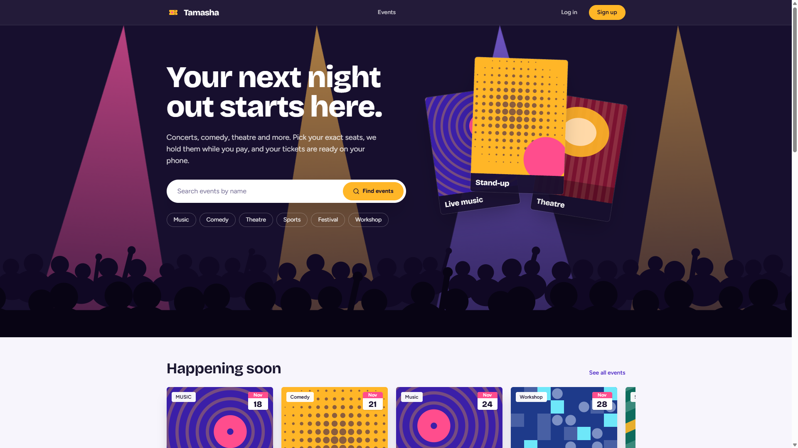
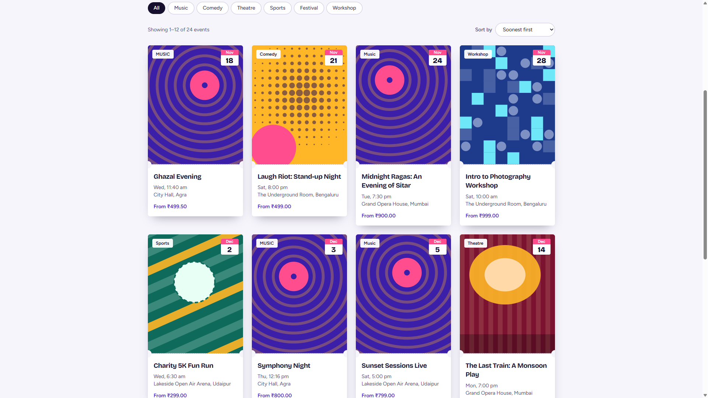
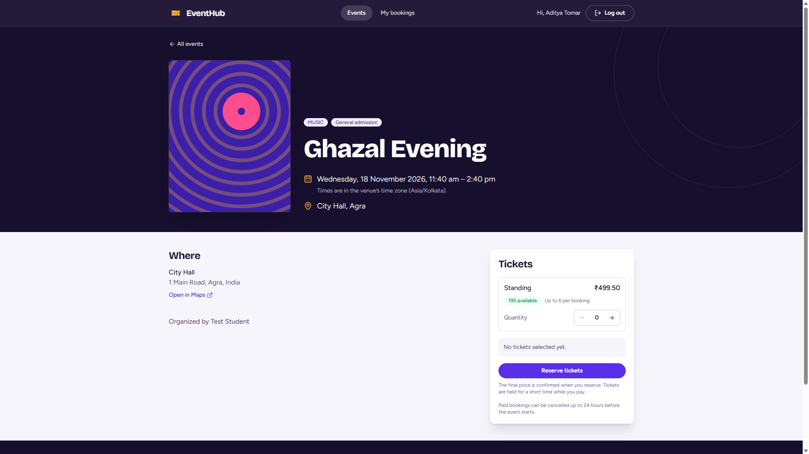
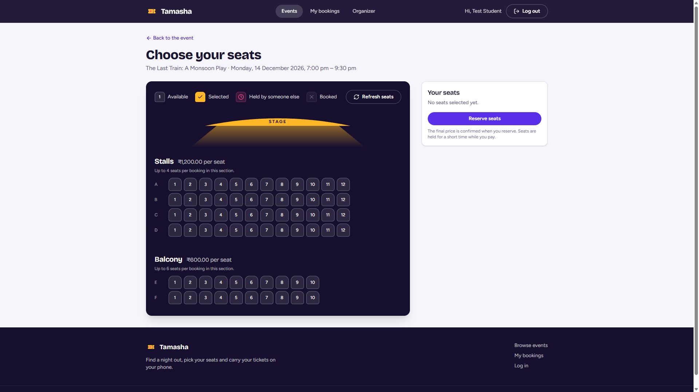
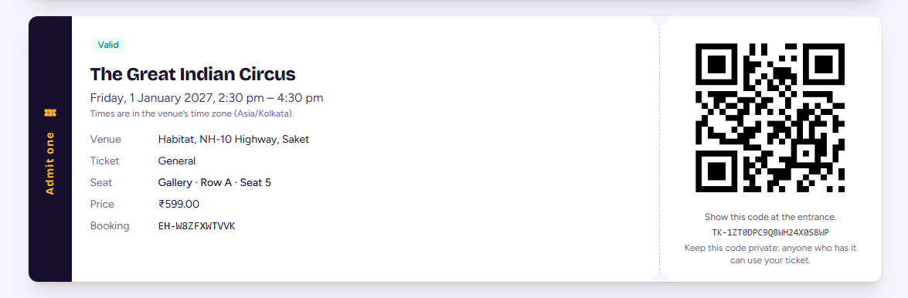
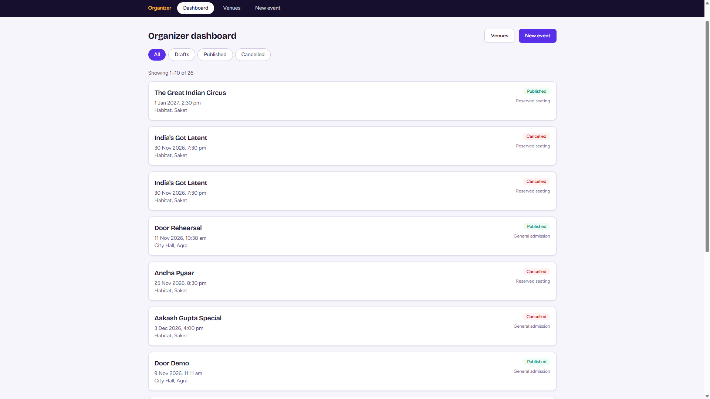
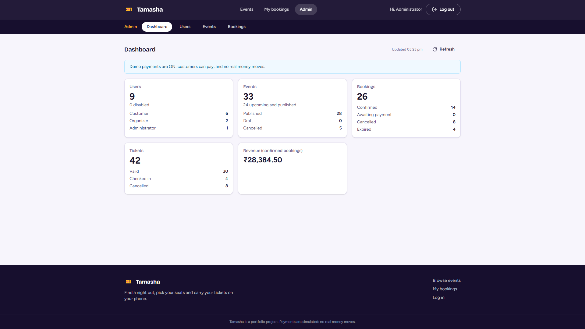
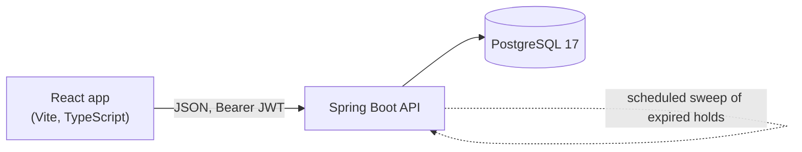
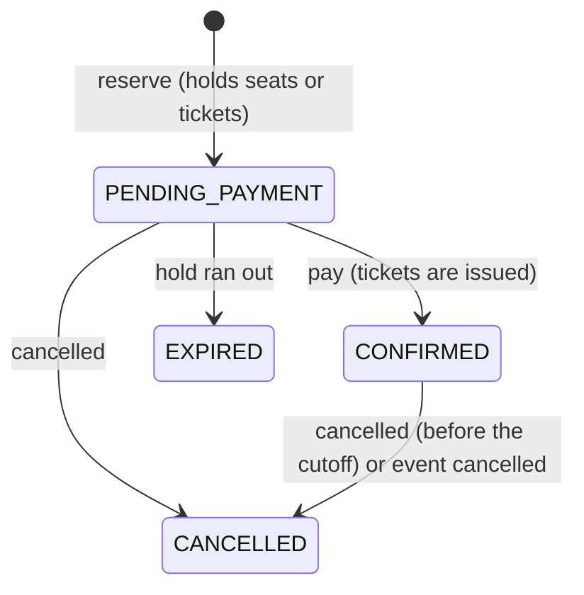

# Tamasha

[](https://github.com/chaudharyadityaa/tamasha/actions/workflows/ci.yml)

**Tamasha is a full-stack event discovery and ticket booking platform.** Customers find events, pick exact seats on a live seat map (or buy general-admission tickets), pay, and get QR-code tickets. Organizers run events, sell tickets and check people in at the door. Administrators oversee the whole platform.

It is a portfolio project built to show how a real booking system handles the hard parts: two people reaching for the same seat, retried requests, expiring holds, time zones, and who is allowed to do what.

> **Payments are simulated.** A clearly labelled demo payment confirms bookings; no real money ever moves.

| | |
|---|---|
|  |  |
|  |  |
|  |  |



## What it does

**Customers**
- Search and filter events by name, category, city, date range and price, with sorting and pagination. Filters live in the URL, so a search can be shared.
- Book **reserved seats** on an interactive seat map (keyboard accessible, refreshes as others book) or **general-admission tickets** by quantity.
- Seats are held for 15 minutes while paying; the countdown is shown.
- Pay with the demo payment, view bookings (upcoming, past, cancelled), cancel paid bookings until a cutoff before the event, and print tickets.
- Tickets are shown as stubs with a **QR code**.

**Organizers**
- Create venues, set up seat sections (for example `A-F` rows by 20 seats), create events, add ticket types and sales windows.
- Publish, unpublish and cancel events. Cancelling cascades: bookings are cancelled, seats and tickets released, demo payments refunded.
- Sales numbers, bookings per event, and a **check-in screen** (scan or type a ticket code; a ticket can be admitted only once).

**Administrators**
- Platform dashboard, user management (enable or disable accounts, change roles), and platform-wide event and booking management with admin cancellation.

## Quick start

You need **Docker**, **JDK 21** and **Node 24**. The commands below are for **Windows PowerShell**, the platform this was developed and tested on. On macOS or Linux, use `export NAME=value` instead of `$env:NAME = "value"`, and `./mvnw` instead of `.\mvnw.cmd`.

**1. Get the code and configure the database**

```powershell
git clone https://github.com/chaudharyadityaa/tamasha.git
cd tamasha
Copy-Item .env.example .env
notepad .env        # set POSTGRES_PASSWORD to a password of your choice
```

**2. Start PostgreSQL** (it listens on `localhost:5433`, only on your machine)

```powershell
docker compose up -d
```

**3. Start the backend** in this window. The environment variables only last for this window.

```powershell
cd backend
$env:EVENTHUB_DB_PASSWORD = "the-same-password-as-POSTGRES_PASSWORD"
$env:EVENTHUB_JWT_SECRET = "a-random-secret-of-at-least-32-characters"
$env:EVENTHUB_ADMIN_EMAIL = "admin@example.com"                 # the first administrator
$env:EVENTHUB_ADMIN_PASSWORD = "choose-a-strong-password"
$env:EVENTHUB_DEMO_PAYMENTS = "true"                           # lets the demo payment work
.\mvnw.cmd spring-boot:run
```

To generate a good secret: `[Convert]::ToBase64String((1..48 | % { Get-Random -Max 256 }))` is fine for local use. The database schema is created automatically by Flyway on first start. The API is then at `http://localhost:8080`.

**4. Start the frontend** in a second window

```powershell
cd frontend
npm install
npm run dev
```

Open **http://localhost:5173**.

**5. (Optional) Fill it with demo data** in a third window. This creates venues, seats, seven published events across all categories, and a few paid bookings, through the public API:

```powershell
powershell -ExecutionPolicy Bypass -File .\scripts\seed-demo.ps1 -AdminEmail "admin@example.com"
```

It asks for the admin password, and refuses to run against anything but `localhost`. It creates three demo accounts that share the password `Demo-Pass-2026!`: `organizer@demo.test` (organizer), `ana@demo.test` and `ravi@demo.test` (customers with tickets). These accounts exist for local use only.

API documentation (Swagger UI, grouped by audience) is at **http://localhost:8080/swagger-ui.html**.

## How it is built



| Layer | Technology |
|---|---|
| Backend | Java 21, Spring Boot 4, Spring Security (JWT resource server), Spring Data JPA (Hibernate 7), Flyway, springdoc-openapi, ZXing (QR codes) |
| Database | PostgreSQL 17 (Docker Compose for local development) |
| Frontend | React 19, TypeScript, Vite, Tailwind CSS 4, React Router, Axios |
| Tests | JUnit with Testcontainers (real PostgreSQL), Vitest, Testing Library, axe-core |
| CI | GitHub Actions: backend and frontend jobs on every push and pull request |

The backend is organised by feature (`user`, `venue`, `event`, `seating`, `booking`, `auth`, `admin`, `security`, `common`). Where one feature needs another (an organizer cancelling an event must cancel its bookings), it depends on a small interface that the other feature implements, so the packages never form a cycle.

A booking moves through a small state machine:



## Engineering decisions worth discussing

**No double booking, even under concurrency.**
A seat can be held by only one active booking, and that is enforced **by the database**, not just by application code: a partial unique index on active booking seats. General-admission stock is reduced by a single atomic `UPDATE`, so it cannot oversell. Organizer actions that change an event (cancel, unpublish) take a stronger row lock than customers booking it, so a booking and a cancellation can never interleave into an inconsistent state. These behaviours are covered by tests that run **real threads against a real PostgreSQL**: a seat race, a general-admission oversell attempt, a booking racing a cancellation, and eight door scanners presenting the same ticket, where exactly one is admitted.

**Retries are safe (idempotency).**
Creating a booking takes an `Idempotency-Key` header. Repeating the request with the same key returns the same booking instead of reserving twice, so a double click or a network retry cannot cost anyone twice. The frontend creates a fresh key for each distinct attempt.

**The server decides prices and permissions.**
The browser sends only ticket types, quantities or seat ids. The server prices everything and re-checks every rule; totals shown in the browser are a preview. Role-based pages in the frontend exist for convenience, while the API enforces roles itself, re-checks the role in the database (so a demoted or disabled account loses access immediately, even with a valid token), and answers 404 for another organizer's data so it does not reveal it exists.

**Holds expire.**
Unpaid bookings hold seats for 15 minutes. Expired holds are released lazily when someone else reaches for the seat, and by a scheduled sweeper that uses `SKIP LOCKED` so several instances could run it safely.

**Tickets and check-in.**
Tickets are issued when a booking is paid and voided when it is cancelled. QR codes are generated on the server and only for valid tickets. Check-in is a single atomic `UPDATE ... WHERE status = 'VALID'`, so a ticket cannot be admitted twice, and it works only inside a window around the event.

**Time zones.**
Instants are stored in UTC. Each venue has an IANA time zone, and events are shown in the venue's own zone, whatever zone the visitor is in. When an organizer types "7:00 pm" for a venue in Mumbai or New York, the frontend converts it to the right UTC moment, including daylight saving, using the browser's `Intl` support (tested for both).

**Security basics.**
Passwords are hashed with BCrypt. Access tokens are signed JWTs with a short life (60 minutes). Login and registration are rate limited. CORS allows only listed origins (a wildcard is refused). Request bodies are size limited, error responses never leak internals, secrets come only from the environment, and API documentation can be switched off.

**Frontend quality.**
All search state lives in the URL, so views are shareable and the back button works. A single typed API layer turns every failure into one error shape, so pages show friendly messages (including rate-limit waits). Slow requests are cancelled when no longer needed. The seat map is a real keyboard widget (arrow keys, one tab stop per section, spoken seat names, state shown by icon as well as colour). Rarely used pages are loaded on demand. Event posters are **drawn by code** from each event's category, so every event looks good without photos. Automated accessibility checks (axe-core) run in the test suite.

## Configuration

**Database container** (root `.env`, read by Docker Compose)

| Variable | Required | Default |
|---|---|---|
| `POSTGRES_PASSWORD` | yes | none |
| `POSTGRES_DB` | no | `eventhub` |
| `POSTGRES_USER` | no | `eventhub_app` |

**Backend** (environment variables)

| Variable | Required | Default | Purpose |
|---|---|---|---|
| `EVENTHUB_DB_PASSWORD` | yes | none | Database password (same as `POSTGRES_PASSWORD`) |
| `EVENTHUB_JWT_SECRET` | yes | none | Signing key for access tokens, at least 32 characters |
| `EVENTHUB_DB_URL` | no | `jdbc:postgresql://localhost:5433/eventhub` | JDBC URL |
| `EVENTHUB_DB_USER` | no | `eventhub_app` | Database user |
| `EVENTHUB_ADMIN_EMAIL`, `EVENTHUB_ADMIN_PASSWORD` | no | unset | Creates the first administrator at startup if both are set (never changes an existing account) |
| `EVENTHUB_DEMO_PAYMENTS` | no | `false` | Enables the demo payment. **Never enable in production.** |
| `EVENTHUB_CORS_ORIGINS` | no | `http://localhost:5173` | Comma-separated browser origins allowed to call the API |
| `EVENTHUB_API_DOCS_ENABLED` | no | `true` | Turns Swagger UI and the OpenAPI document on or off |

Other settings (hold duration, sweeper interval, check-in window, rate limits, body size limit) are documented in `backend/src/main/resources/application.properties`.

**Frontend:** `VITE_API_BASE_URL` (default `http://localhost:8080`, set in `frontend/.env.development`). It is public, so never put a secret in a `VITE_` variable.

## Running the tests

```powershell
# Backend: needs Docker running, because Testcontainers starts a throwaway PostgreSQL
cd backend
.\mvnw.cmd clean test

# Frontend
cd frontend
npm run lint
npm test
npm run build
```

There are over 200 backend tests (unit, web layer, repository and full-stack integration tests, plus the concurrency tests described above) and over 250 frontend tests (logic, components, pages with mocked APIs, and accessibility audits). If the backend build complains about a missing `EVENTHUB_JWT_SECRET` or `EVENTHUB_DB_PASSWORD`, set any placeholder values, as the CI workflow does.

## Project layout

```
backend/    Spring Boot API (feature packages, Flyway migrations, tests)
frontend/   React app (pages, components, API layer, tests)
scripts/    seed-demo.ps1: fills a local backend with demo data
docs/       screenshots
docker-compose.yml   local PostgreSQL
.github/    CI workflow and Dependabot configuration
```

## Known limitations and next steps

Being honest about these is part of the design:

- **Demo payments only.** A real provider would need signed webhooks and idempotent payment confirmation; the booking and payment model is already shaped for that (one successful payment per booking, enforced by a unique index).
- **No refresh tokens.** Access tokens last 60 minutes and live in `sessionStorage`; people log in again afterwards. Cookie-based sessions with refresh rotation would be the next hardening step.
- **In-memory rate limiting.** It is per server instance; behind several instances or a proxy it would need a shared store and correct forwarded-header handling.
- **No email notifications** (booking confirmations, reminders).
- Booking references still use the project's original prefix (`EH-`), from its earlier working name.

## A note on names

The product is called **Tamasha**. Internal identifiers such as the Java package (`com.eventhub`), the container name and the `EVENTHUB_*` environment variables keep the project's original working name; they are invisible to users and were deliberately left alone.